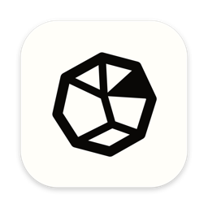
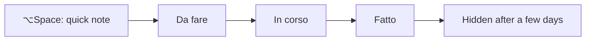

  

<h1 align="center">DevOS Kanban</h1>

  A small kanban board that lives in the macOS menu bar. 
  Capture tasks and notes in a second, even in the middle of a meeting.

  <a href="https://github.com/DanieleRiccelli/devos-kanban-releases/releases/latest"><strong>Download the latest release</strong></a>

---

This repository hosts DevOS Kanban's installers and its update feed. The source code is private.

## Why DevOS Kanban

Most task apps want a window, an account and your attention. DevOS Kanban stays out of the way:

- **It is one shortcut away.** Press ⌥Space from any app, type, press Return. The card is saved and the panel gets out of the way.
- **It is not in the Dock.** It lives in the menu bar and opens as a floating panel above your other windows.
- **Cards hold notes, not just titles.** Each card has a timeline of notes with formatted text, checklists, code blocks and images.
- **Done means done.** Cards that reach the last column crumple like paper and, after a few days, leave the board.

## Install

You need a Mac with macOS 14 or later, Apple Silicon or Intel. The same DMG works on both.

1. Download the DMG from the [latest release](https://github.com/DanieleRiccelli/devos-kanban-releases/releases/latest).
2. Open it and drag **DevOS Kanban** into **Applicazioni**.
3. Open DevOS Kanban. macOS blocks the first launch, because the app is self-signed rather than signed with an Apple Developer ID.
4. Go to **System Settings → Privacy & Security → Open Anyway** and confirm.

The app appears as an icon in the menu bar, not in the Dock. Its interface is in Italian.

## Getting started

1. **Open the panel.** Click the menu bar icon or press ⌥Space. Right-click the icon for *Apri* and *Chiudi*.
2. **Add a card.** Type in the field at the bottom and press Return: the card goes into the column shown in the field. Switch column with ⌘1–⌘9.
3. **Choose a size.** Move between a mini strip, a compact panel with one tab per column, and the full board.
4. **Move work along.** Drag cards between columns, and drag columns to reorder them.
5. **Write notes.** Click a card to open its notes. Paste or drop images, and right-click a note to edit or delete it.

## What's inside

| Feature | What it does |
| --- | --- |
| **Quick capture** | A global shortcut, ⌥Space by default, opens the panel from any app |
| **Three sizes** | Mini strip, compact panel with tabs, full board; the panel can be pinned above other windows |
| **Notes** | A timeline per card with Markdown, checklists, code blocks with a copy button, links and images |
| **Images** | Paste with ⌘V, drop from the Finder or pick a file; stored next to the database |
| **Completed cards** | The last column is the done column; cards there are hidden after 1, 3, 7, 14 or 30 days, and can be shown again |
| **Columns** | Add, rename, reorder and delete them in **Impostazioni → Colonne** |

## Updates

DevOS Kanban checks for a new version when it opens, every hour, and when you come back to it after more than an hour. You can also check from **Impostazioni → Aggiornamenti → Controlla ora**.

A new version shows a button in the panel header. Nothing is downloaded or installed until you confirm. Installing restarts the app; notes being written are already saved.

> 1.0.0 is the first version with the updater: earlier builds have to be replaced by hand with the DMG.

## Your data

Cards, notes and images stay on your Mac, in `~/Library/Application Support/DevOSKanban`, and survive updates. There is no account and no telemetry. The only connection is the update check.

To uninstall, quit DevOS Kanban from its menu bar icon and delete it from **Applicazioni**. Delete the folder above to remove your data too.

## Limitations

- The app is not notarized, so each new install needs the **Open Anyway** step.
- One board per Mac, with no sync between devices.
- The interface is in Italian only.
